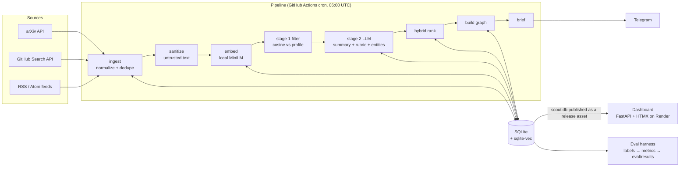

# Research Scout — Plan & Architecture

Build window: **2026-10-18 (Day 1) → 2026-10-24 (Day 7)**, ~2–3 focused hours/day.

## 1. What it is

A daily research agent for the *LLM agents / evaluation / RAG* field. Every morning (06:00 UTC):

1. **Ingest** new arXiv papers, GitHub repos, and blog posts.
2. **Rank** them against an interest profile (embedding similarity + LLM rubric).
3. **Summarize** the top-K into structured JSON and extract entities into a knowledge graph.
4. **Deliver** a Telegram brief and refresh a public, read-only dashboard.
5. **Measure** itself: an eval harness compares outputs to hand labels.

The point of the project is not the plumbing — it's being able to show *measured* quality:
ranking nDCG, summary faithfulness, and how well an LLM judge agrees with a human.

## 2. Architecture

**Design principles**

- **Every stage reads from and writes to the DB only.** That makes each CLI command
  (`scout ingest`, `scout rank`, …) independently runnable and idempotent, and lets
  `run-daily` be a simple chain that records per-stage status instead of crashing.
- **Side effects at the edges.** Network (`ingest/`, `llm/`, Telegram) and DB live in thin
  adapters; parsing, dedupe, scoring math, and metrics are pure functions → easy to test offline.
- **Untrusted content is data.** Fetched text is sanitized, truncated, and wrapped in
  `<document>` delimiters; the system prompt says document text is never instructions.
- **Cost is enforced, not observed.** The budget guard estimates a call's cost *before* making it
  and refuses past the daily cap. LLM responses are cached by `(prompt_version, model, content_hash)`.

### How the DB reaches the dashboard (Render free tier)

Render's free web service sleeps after ~15 min idle and has no persistent disk we can rely on.
So the dashboard is **read-only over a snapshot**: the daily Action runs the pipeline, publishes
`scout.db` as a release asset (tag `data`), and hits Render's deploy hook; the app downloads the latest
snapshot on boot. Write actions (feedback) are token-gated and queued for the next run.
See ADR-002.

## 3. Data model (SQLite)

| Table | Key columns | Purpose |
|---|---|---|
| `items` | `id` (source:native_id), `source`, `url`, `title`, `authors` (JSON), `published_at`, `fetched_at`, `body`, `content_hash`, `raw_metadata` (JSON) | One row per unique paper/repo/post |
| `item_vectors` | `item_id`, `embedding` (vec0, 384-d) | Semantic search, profile similarity |
| `summaries` | `item_id`, `prompt_version`, `model`, `json`, `created_at` | Structured summaries, versioned |
| `scores` | `item_id`, `run_id`, `emb_score`, `llm_score` (JSON rubric), `hybrid`, `rank` | Per-run ranking → enables "rank moved vs yesterday" |
| `entities` | `id`, `type` (Paper/Author/Concept/Method/Repo/Org), `name`, `aliases`, `first_seen_at` | Graph nodes |
| `edges` | `src`, `dst`, `relation`, `item_id`, `created_at` | Graph edges with provenance |
| `runs` | `id`, `started_at`, `finished_at`, `status`, `items_fetched/new/failed`, `tokens`, `cost_usd`, `latency_ms` | Observability |
| `source_status` | `run_id`, `source`, `status`, `error`, `items` | Per-source health |
| `llm_cache` | `key` (hash of prompt_version+model+content_hash), `response`, `tokens` | Cost control |
| `feedback` | `item_id`, `vote` (+1/-1), `created_at` | Rocchio profile update |
| `labels` | `item_id`, `relevance` 0–3, `faithfulness`/`coverage`/`conciseness` 1–5, `entities_ok` | Human ground truth |

The graph is **not** stored as a pickled NetworkX object: `entities` + `edges` are the source of
truth and NetworkX is built from them on demand. Trending concepts = a SQL query on edge growth.

## 4. The 7-day plan

Each bullet ≈ one commit. ⬆ = push checkpoint.

### Day 1 — Sun 18 Oct · Foundation + arXiv
Goal: `scout ingest` pulls real arXiv papers into SQLite, idempotently, with CI green.
- Scaffold (uv, ruff, mypy, pytest, pre-commit), plan + ADRs
- Config: pydantic-settings, `config/sources.yaml`, `config/profile.yaml`
- SQLite migrations + `Item` model; JSON logging; `justfile` ⬆
- HTTP client with retry/backoff/jitter + User-Agent; `Source` protocol
- arXiv source + recorded fixture + parser/dedupe tests
- `scout ingest` CLI end-to-end ⬆
- CI workflow; sqlite-vec loading spike; DEVLOG; tag `day-1` ⬆

### Day 2 — Mon 19 Oct · More sources + safety
Goal: three sources flowing daily, injection defenses tested.
- GitHub source (topic search + star velocity) · RSS source (4 verified feeds)
- Sanitizer + prompt-injection fixtures (incl. a canary test)
- `runs` / `source_status` tables, `scout run-daily` skeleton
- **Daily cron Action** (ingest only) → real data starts accumulating; DB published as a release asset

### Day 3 — Tue 20 Oct · LLM, ranking, delivery
Goal: a real ranked brief arrives on Telegram.
- LLM provider interface: Gemini (default), Anthropic, Fake (offline tests/demo)
- Cache, budget guard (pre-call estimate), rate limiter
- Summarizer (`prompts/summarize_v1.md`, pydantic-validated JSON)
- Local embeddings + hybrid ranking with score breakdown
- `scout brief` + Telegram + failure alerts
- Optional n8n hook: `scout brief` POSTs the brief JSON to `SCOUT_N8N_WEBHOOK_URL` when set (ADR-009)
- Minimal `scout label` → **start labeling 10 items/day** (de-risks Day 6)

### Day 4 — Wed 21 Oct · Vector search + knowledge graph
- sqlite-vec storage, semantic search, "more like this"
- Entity/relation extraction with alias merging
- Graph queries: neighbors, trending, shortest path, clusters

### Day 5 — Thu 22 Oct · Dashboard
Priority order (later items are the first to slip): Today's brief → Run status →
What changed today → Search/Ask (RAG with citations, "not enough evidence" fallback) →
Graph explorer (Cytoscape.js) → feedback buttons + Rocchio update.

### Day 6 — Fri 23 Oct · Evaluation (the headline feature)
- Finish labels (30 items), metrics module (P@k, nDCG@k, entity P/R/F1)
- LLM judge + non-LLM baseline; judge-vs-human Cohen's kappa
- Ablation: TF-IDF vs embeddings vs hybrid; results per prompt/model version; Eval page
- CI regression gate on the fixture set

### Day 7 — Sat 24 Oct · Deploy + polish
- Dockerfile, Render deploy, `/healthz`, secrets, demo mode with seeded snapshot
- Verify in a private window as a stranger
- n8n workflows (`n8n/*.json`: daily brief, failure alert, feedback) + `docs/n8n.md`; first item to cut if behind
- README (problem → GIF → live link → results table → architecture → quickstart → lessons →
  limitations → next), secrets scan of history, tag `day-7` + `v1.0.0`

## 5. Your manual to-dos

| When | What |
|---|---|
| Before Day 2 | GitHub fine-grained token (public repos, read-only) → `GITHUB_TOKEN` in `.env` |
| Before Day 3 | Gemini API key (Google AI Studio); Telegram bot via @BotFather + your chat ID |
| Day 3 → 6 | Hand-label ~10 items/day with `scout label` (30 total, no LLM labels) |
| Before Day 7 | Render account; record the 60-second demo GIF |

## 6. Risks

| Risk | Mitigation |
|---|---|
| Gemini free-tier quotas change | Limits in config, cache, Fake provider, Anthropic fallback |
| Cron ↔ dashboard DB handoff | Snapshot-on-`data`-branch design (ADR-002), built on Day 2 not Day 7 |
| Hand labels slip | Labeling starts Day 3, 10/day |
| sqlite-vec loading on Linux/Docker | Day 1 spike; fallback = numpy brute-force cosine (fine at <50k items) |
| Dashboard scope | Strict page priority order on Day 5 |

## 7. After the week

- **Accumulate runs** — the cron keeps going; the "≥7 consecutive briefs" bar is met by ~Day 9–10.
- **Re-run evals** with more labels (target 100) and report confidence intervals.
- **Prompt iteration** — `summarize_v2` vs `v1` comparison table driven by the harness.
- **Learning-to-rank** from accumulated feedback votes instead of fixed weights.
- **Cross-encoder reranker** for Ask-the-scout retrieval; measure retrieval recall separately.
- **More sources** — Semantic Scholar citations, Papers with Code, conference proceedings.
